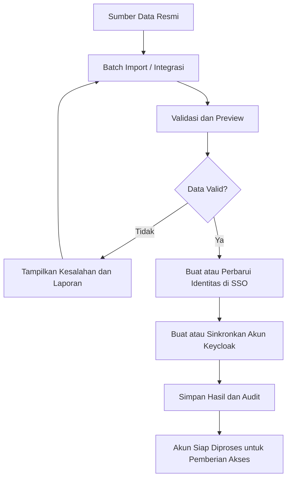
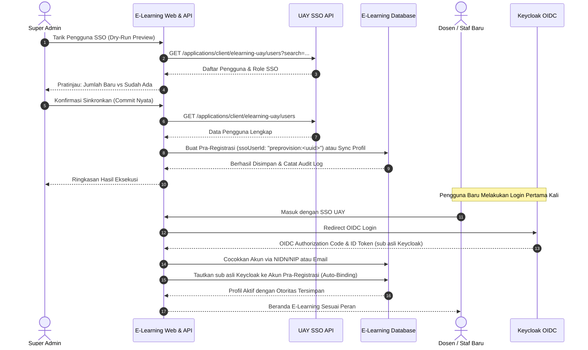
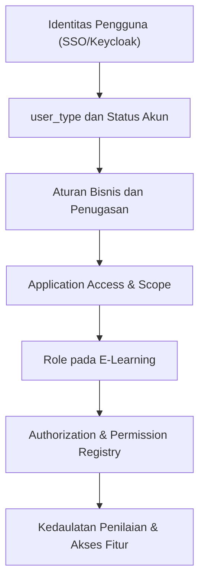
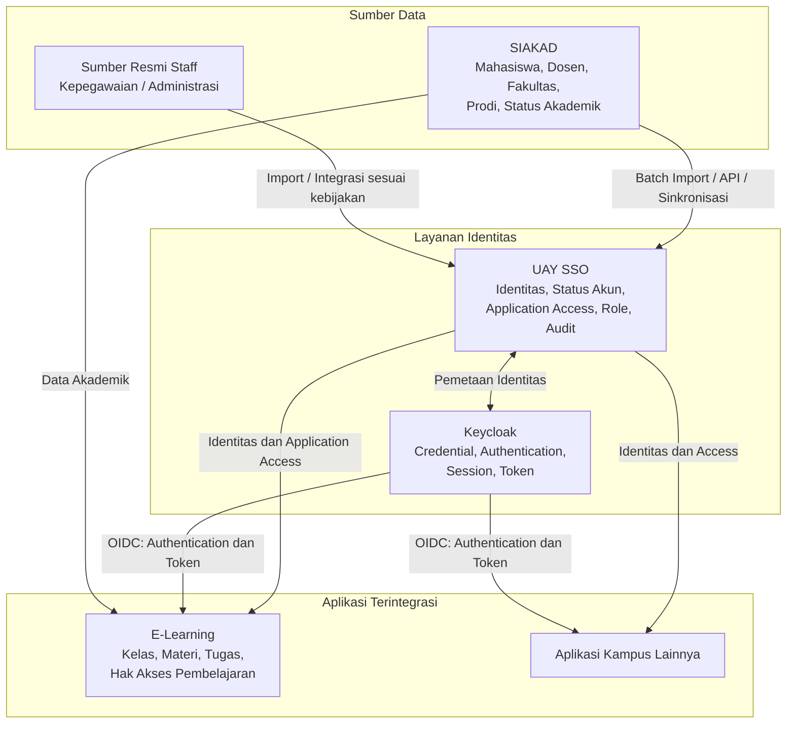

# Arsitektur Pengelolaan Identitas dan Data Akademik UAY

**Kategori:** Architecture Decision Record  
**Status:** Baseline Desain  
**Lingkup:** UAY SSO, Keycloak, SIAKAD, E-Learning, dan aplikasi terintegrasi  
**Tujuan:** Menetapkan pembagian kepemilikan data pengguna, pengelolaan fakultas dan program studi, batch import, sinkronisasi, serta penetapan akses aplikasi.

## 1. Latar Belakang dan Keputusan Arsitektur

Platform Digital UAY memerlukan mekanisme identitas terpusat agar mahasiswa, dosen, dan staff dapat menggunakan akun kampus untuk mengakses aplikasi yang terintegrasi. Pada saat yang sama, setiap kategori pengguna memiliki atribut dan kebutuhan yang berbeda. Mahasiswa memiliki data akademik seperti NIM, fakultas, program studi, angkatan, dan status akademik. Dosen memiliki identitas kepegawaian serta kemungkinan hubungan dengan fakultas dan program studi. Staff memiliki identitas kepegawaian dan penugasan administratif yang tidak selalu berkaitan dengan struktur akademik.

Untuk menghindari duplikasi dan ketidakkonsistenan data, pengelolaan identitas dipisahkan dari pengelolaan data akademik. UAY SSO menjadi sumber utama identitas pengguna dan akses aplikasi, sedangkan SIAKAD menjadi sumber utama data akademik. Keycloak menangani autentikasi, kredensial, sesi, dan penerbitan token. E-Learning menggunakan identitas SSO dan data akademik yang relevan untuk menjalankan proses pembelajaran.

Pemisahan tersebut tidak melarang SSO menyimpan atribut akademik sebagai referensi. Namun, apabila atribut fakultas atau program studi disimpan di SSO, data tersebut tidak boleh menjadi master data independen yang dikelola tanpa mekanisme sinkronisasi dengan sumber resminya.

## 2. Pembagian Tanggung Jawab Sistem

| Sistem | Data dan tanggung jawab utama |
|---|---|
| UAY SSO | Identitas pengguna, identifier, status akun, pemetaan akun Keycloak, application access, role aplikasi, delegasi administrator, audit, dan proses pengelolaan akun. |
| Keycloak | Kredensial, autentikasi, sesi, token, serta mekanisme protokol OIDC. |
| SIAKAD | Data mahasiswa, dosen dalam konteks akademik, fakultas, program studi, angkatan, status akademik, dan relasi akademik yang dikelolanya. |
| Sumber data kepegawaian atau administratif resmi | Data kepegawaian dan penugasan staff, apabila tersedia dan ditetapkan sebagai sumber resmi oleh UAY. |
| E-Learning | Kelas, peserta kelas, materi, tugas, pengumpulan tugas, dan hak akses terhadap aktivitas pembelajaran. |
| Aplikasi terintegrasi lainnya | Data dan aturan bisnis yang menjadi tanggung jawab masing-masing aplikasi. |

Sumber resmi data staff belum ditetapkan dalam desain ini. Apabila UAY belum memiliki sistem kepegawaian terintegrasi, pembuatan akun staff dapat menggunakan batch import atau mekanisme administrasi yang disetujui. Mekanisme tersebut perlu diperlakukan sebagai sumber data sementara sampai sumber resmi dan proses pembaruannya ditetapkan.

## 3. Model Identitas Mahasiswa, Dosen, dan Staff

SSO menggunakan atribut `user_type` untuk membedakan kategori pengguna. Nilai yang digunakan pada model saat ini adalah `STUDENT`, `LECTURER`, dan `STAFF`.

Atribut tersebut menunjukkan jenis pengguna, bukan jabatan, fakultas, program studi, atau hak akses aplikasi. Satu kategori pengguna dapat memiliki banyak kemungkinan akses sesuai kebutuhan dan penugasan yang sah.

### 3.1. Mahasiswa

Data akademik mahasiswa berasal dari SIAKAD. SSO menyimpan identitas minimum yang diperlukan untuk membuat akun, menghubungkan identitas tersebut dengan Keycloak, serta mengelola akses aplikasi.

Data mahasiswa yang relevan dapat meliputi:

- NIM sebagai identifier resmi.
- Nama dan atribut identitas dasar.
- Kategori pengguna `STUDENT`.
- Status akun SSO.
- Pemetaan akun Keycloak.
- Application access dan role aplikasi.

Data akademik yang menjadi tanggung jawab SIAKAD meliputi fakultas, program studi, angkatan, status akademik, serta relasi mahasiswa dengan kegiatan akademik.

Mahasiswa tidak otomatis memperoleh akses ke E-Learning hanya karena terdaftar di SSO. Penetapan akses ke kelas dan mata kuliah tetap mengikuti data akademik serta aturan bisnis E-Learning.

### 3.2. Dosen

Dosen menggunakan kategori `LECTURER` dan memiliki identifier resmi, misalnya NIP atau identifier kepegawaian lain yang ditetapkan UAY.

SSO mengelola identitas akun dan akses aplikasinya. Data dosen dalam konteks akademik, termasuk relasi fakultas, program studi, dan penugasan mengajar, dikelola oleh SIAKAD sesuai cakupan sistem tersebut.

Seseorang yang terdaftar sebagai dosen tidak otomatis mendapatkan role administrator E-Learning atau SSO. Akses sebagai dosen di E-Learning dan penugasan kelas harus ditentukan berdasarkan data serta aturan yang relevan.

### 3.3. Staff

Staff menggunakan kategori `STAFF`. Data identitas dan kepegawaiannya harus berasal dari sumber resmi yang ditetapkan UAY. Apabila sumber tersebut belum tersedia, data dapat dimasukkan melalui batch import atau administrasi oleh pihak berwenang.

SSO tidak menganggap seluruh staff sebagai administrator. Staff administrasi akademik, staff fakultas, pengelola aplikasi, dan pengelola platform dapat memiliki kebutuhan akses yang berbeda. Penetapan application access dan role harus berdasarkan penugasan serta kewenangan yang disetujui.

Jika kelak dibutuhkan informasi unit kerja, fakultas, atau bagian administratif, data tersebut dapat diintegrasikan dari sumber resmi kepegawaian. Informasi tersebut tidak harus menjadi master data di SSO.

## 4. Pembagian Data dan Kepemilikan Atribut

Pemisahan data perlu dilakukan berdasarkan siapa yang bertanggung jawab atas kebenaran dan pembaruannya, bukan semata-mata berdasarkan aplikasi yang membutuhkan data tersebut.

| Atribut | Sumber utama | Penggunaan di SSO |
|---|---|---|
| `user_id` | UAY SSO | Identifier internal pengguna. |
| NIM | SIAKAD atau sumber resmi yang ditetapkan | Identifier untuk pencocokan identitas mahasiswa. |
| NIP atau identifier dosen | Sumber resmi kepegawaian/akademik | Identifier untuk pencocokan identitas dosen. |
| Identifier staff | Sumber resmi kepegawaian atau administratif | Identifier untuk pencocokan identitas staff. |
| `user_type` | Data resmi hasil registrasi atau sinkronisasi | Kategori `STUDENT`, `LECTURER`, atau `STAFF`. |
| `status` akun SSO | UAY SSO berdasarkan kebijakan akun | Menentukan apakah akun boleh digunakan untuk autentikasi dan akses. |
| Fakultas | SIAKAD | Tidak wajib menjadi master data SSO; dapat menjadi atribut referensi jika diperlukan. |
| Program studi | SIAKAD | Tidak wajib menjadi master data SSO; dapat menjadi atribut referensi jika diperlukan. |
| Angkatan | SIAKAD | Digunakan oleh aplikasi yang membutuhkan konteks akademik. |
| Status akademik | SIAKAD | Menjadi input kebijakan akses, bukan pengganti status akun SSO. |
| Kredensial dan sesi | Keycloak | Tidak disimpan sebagai kredensial di database UAY SSO. |
| Application access | UAY SSO | Menentukan aplikasi yang boleh diakses pengguna. |
| Role aplikasi | UAY SSO | Menentukan role yang diberikan kepada pengguna untuk aplikasi tertentu. |
| Hak akses fitur dan resource | Aplikasi terkait | Diperiksa oleh backend aplikasi sesuai kebijakan authorization masing-masing. |

SSO tidak perlu membuat tabel `faculties` dan `study_programs` sebagai master data untuk kebutuhan saat ini. Jika integrasi memerlukan referensi fakultas atau prodi, penyimpanan atribut seperti `faculty_id` atau `study_program_id` dapat dipertimbangkan setelah kebutuhan, format identifier, dan mekanisme sinkronisasinya ditentukan.

NIM dan NIP digunakan untuk pencocokan identitas, bukan untuk menebak fakultas atau program studi berdasarkan pola nomor. Informasi akademik harus diperoleh dari sumber data yang berwenang.

## 5. Batch Import dan Sinkronisasi Data

Batch import merupakan mekanisme untuk membuat atau memperbarui akun pengguna secara massal. Penggunaan batch import tidak menjadikan seluruh kolom dalam file sebagai master data SSO. Kepemilikan setiap atribut tetap mengikuti sumber data yang ditetapkan.

Untuk mahasiswa dan dosen, data akademik sebaiknya bersumber dari SIAKAD. Untuk staff, sumbernya mengikuti sistem kepegawaian atau mekanisme administrasi resmi yang ditetapkan UAY. Apabila integrasi otomatis belum tersedia, file batch dapat digunakan sebagai mekanisme awal dengan proses validasi dan persetujuan yang jelas.

### 5.1. Alur Batch Import

Alur tersebut menggambarkan mekanisme yang direkomendasikan. Urutan implementasi pembuatan akun SSO dan Keycloak harus memperhitungkan kegagalan parsial agar tidak menghasilkan akun yang tidak konsisten.

### 5.2. Validasi Batch

Sebelum data diproses, sistem perlu melakukan validasi berikut:

1. Memastikan identifier resmi tersedia dan memiliki format yang valid.
2. Memeriksa duplikasi identifier di dalam file maupun terhadap data yang telah terdaftar.
3. Memvalidasi kategori pengguna dan atribut wajib.
4. Memvalidasi referensi fakultas dan program studi terhadap sumber resmi apabila atribut tersebut disertakan.
5. Menampilkan preview jumlah data baru, data yang diperbarui, data yang ditolak, dan data yang memerlukan pemeriksaan.
6. Mencatat hasil pemrosesan untuk kebutuhan audit dan penelusuran kesalahan.

Import ulang terhadap identifier yang sudah ada harus mengikuti aturan pembaruan, bukan otomatis membuat identitas baru. Perubahan identifier resmi atau penggabungan identitas harus melalui prosedur khusus untuk mencegah duplikasi akun.

### 5.3. Sinkronisasi Setelah Registrasi

Setelah akun dibuat, perubahan data akademik dapat terjadi, misalnya perubahan nama, perpindahan program studi, perubahan status mahasiswa, atau perubahan penugasan dosen. Perubahan tersebut harus diteruskan melalui mekanisme sinkronisasi yang ditetapkan.

Sinkronisasi perlu memiliki aturan untuk menangani data yang tidak ditemukan, perubahan yang bertentangan, kegagalan proses, dan pengulangan permintaan. Proses yang gagal tidak boleh diam-diam dianggap berhasil. Sistem harus menyediakan log atau laporan yang memungkinkan administrator menindaklanjuti ketidaksesuaian data.

### 5.4. Integrasi Penarikan Pengguna dari SSO dan Pola Pra-Registrasi (Pre-Provisioning)

Untuk mendukung operasional pembelajaran digital yang fleksibel, E-Learning menyediakan fitur penarikan akun terpusat dari SSO Kampus melalui endpoint:
- **SSO Backend API:** `GET /api/v1/applications/client/:clientId/users` (mengambil daftar pengguna yang memiliki hak akses ke client `elearning-uay` dengan pagination dan filter pencarian).
- **E-Learning API:** `POST /api/v1/system/sso/sync-users` (dipicu oleh Super Admin, mendukung mode `dryRun: true` untuk pratinjau dan `dryRun: false` untuk eksekusi komit nyata).

**Karakteristik Kunci Pre-Provisioning:**
1. **Pra-Penugasan:** Dosen baru dapat langsung dijadwalkan mengajar rombel kelas oleh Kaprodi bahkan sebelum dosen tersebut melakukan login perdana.
2. **Preservasi Otoritas Lokal:** Penarikan akun tidak pernah menghapus peran Dekan/Kaprodi maupun `departmentScopes` yang sudah diatur oleh admin di E-Learning.
3. **Seamless Identity Auto-Binding:** Saat dosen/staf pertama kali login melalui OIDC Keycloak, sistem mendeteksi kecocokan identifier (NIDN/NIP/Email) dan menautkan `ssoUserId` asli tanpa membuat duplikasi entitas.

## 6. Penetapan Application Access dan Role

Identitas pengguna, akses aplikasi, dan role merupakan tiga hal yang berbeda. SSO mengetahui siapa pengguna tersebut, aplikasi mana yang boleh diakses, dan role apa yang diberikan untuk aplikasi tersebut. SSO tidak secara otomatis menentukan seluruh hak akses fitur yang ada di dalam aplikasi.

Sebagai contoh, mahasiswa memperoleh role `STUDENT` di E-Learning. Role tersebut tidak otomatis memberikan akses ke semua kelas karena keanggotaan kelas ditentukan berdasarkan data akademik dan aturan E-Learning.

Demikian pula, role `SUPER_ADMIN` merupakan kewenangan institusional tingkat universitas, sedangkan `DEPARTMENT_ADMIN` diberikan secara terfokus pada cakupan program studi tertentu.

### 6.1. Contoh Matriks Pengguna

| Pengguna | `user_type` | Aplikasi | Role E-Learning | Dasar Penetapan & Lingkup |
|---|---|---|---|---|
| Mahasiswa aktif | `STUDENT` | E-Learning | `STUDENT` | Status akademik dan KRS kelas berjalan. |
| Dosen Pengampu | `LECTURER` | E-Learning | `INSTRUCTOR` | Penugasan mengajar rombel kelas resmi. |
| Kaprodi | `LECTURER` / `STAFF` | E-Learning | `DEPARTMENT_ADMIN` | SK Dekan, cakupan single-prodi (misal `["IF"]`). |
| Dekan / Wakil Dekan | `LECTURER` | E-Learning | `DEPARTMENT_ADMIN` | SK Rektor, cakupan multi-prodi fakultas (misal `["IF", "TI", "TS"]`). |
| Super Admin | `STAFF` / `ADMIN` | E-Learning | `SUPER_ADMIN` | SK Rektor, pengelolaan LMS pusat universitas. |
| Rektor / Pimpinan | `LECTURER` / `STAFF` | E-Learning | `RECTOR` | SK Rektor, peninjauan analitik eksekutif universitas (*read-only*). |

### 6.2. Matriks Otoritas Resmi 6 Peran & Kedaulatan Penilaian (Grading Sovereignty)

Dalam arsitektur tata kelola akademik E-Learning UAY Versi 2.0, wewenang dibagi ke dalam 6 peran dengan batasan yang tegas:

| Domain Wewenang | Super Admin | Dekan (Multi-Prodi) | Kaprodi (Single-Prodi) | Dosen Pengampu | Mahasiswa | Rektor |
| :--- | :---: | :---: | :---: | :---: | :---: | :---: |
| Master Data Program Studi & Proteksi Kode | **Kelola** | Tidak | Tidak | Tidak | Tidak | Tidak |
| Deaktivasi Prodi Berelasi (*DEACTIVATED*) | **Kelola** | Tidak | Tidak | Tidak | Tidak | Tidak |
| Penetapan Otoritas Kaprodi & Dekan | **Kelola** | Tidak | Tidak | Tidak | Tidak | Tidak |
| Tarik Pengguna SSO & Pra-Registrasi | **Kelola** | Tidak | Tidak | Tidak | Tidak | Tidak |
| Sinkronisasi Penugasan via SIAKAD Bridge | **Kelola/Mesin** | Tidak | Tidak | Tidak | Tidak | Tidak |
| Kelola Rombel & Kurikulum Prodi | Semua | Fakultas | Prodi | Tidak | Tidak | Tidak |
| Pembuatan Pertemuan, Materi PDF & Video | Semua (Bantu) | Fakultas (Bantu) | Prodi (Bantu) | **Kelas** | Tidak | Tidak |
| Pembukaan Sesi Presensi & PIN 6-Digit | Semua (Darurat) | Fakultas (Darurat) | Prodi (Darurat) | **Kelas** | Tidak | Tidak |
| **Pemberian Nilai Siswa (`GRADE_STUDENT_WORK`)** | **DILARANG** | **DILARANG** | **DILARANG** | **MUTLAK** | Tidak | Tidak |
| **Publikasi & Penguncian Nilai Kelas** | Tidak | Tidak | Tidak | **MUTLAK** | Tidak | Tidak |
| Buka Kunci Nilai (*Unlock Gradebook*) | **Kelola (SK Dekan)** | Tidak | Tidak | Pengajuan | Tidak | Tidak |
| Ekspor Rekap Nilai Prodi/Fakultas | Semua | **Fakultas** | **Prodi** | Kelas | Tidak | Tidak |
| Dasbor Analitik Keaktifan Real-Time | Baca | Baca | Baca | Tidak | Tidak | **Eksklusif** |

> **Prinsip Kedaulatan Penilaian (Grading Sovereignty):**
> Evaluasi dan penetapan nilai angka/huruf mutu mahasiswa merupakan hak prerogatif yang dilindungi hukum bagi Dosen Pengampu yang ditugaskan secara sah. Super Admin, Dekan, maupun Kaprodi secara teknis diblokir dari memanipulasi buku nilai kelas.

### 6.3. Integrasi SIAKAD Bridge untuk Penugasan Struktural

Untuk sinkronisasi otomatis dari sistem informasi akademik induk (SIMAK/SIAKAD), E-Learning menyediakan endpoint mesin-ke-mesin terproteksi:
- `POST /api/v1/system/siakad/sync-scopes`
- Proteksi: Header `X-SIAKAD-Secret` dan header `Idempotency-Key`.
- Fitur: Mode `dryRun: true` untuk simulasi dan audit log otomatis dengan `action: "SYNC_SIAKAD_SCOPES"`.
- Revokasi: Pengiriman `departmentScopes: []` secara otomatis mendemutasi peran akun dari `DEPARTMENT_ADMIN` kembali ke `INSTRUCTOR`.

## 7. Status Akademik dan Status Akun

Status akademik yang dikelola SIAKAD tidak boleh disamakan langsung dengan status akun SSO. Status akademik menjelaskan kondisi seseorang dalam kegiatan akademik, sedangkan status akun SSO menentukan apakah identitas tersebut boleh digunakan untuk autentikasi dan akses aplikasi.

Contoh penanganan:

| Kondisi akademik | Keputusan yang perlu diterapkan |
|---|---|
| Mahasiswa aktif | Akun dan akses diberikan sesuai kebijakan serta kebutuhan aplikasi. |
| Mahasiswa cuti | Dampak terhadap akun dan akses ditentukan berdasarkan kebijakan kampus. |
| Mahasiswa lulus | Akses akademik ditinjau sesuai kebijakan; akun tidak otomatis dihapus tanpa aturan retensi yang jelas. |
| Mahasiswa dinonaktifkan | Perubahan status akademik diproses sesuai kebijakan akses dan prosedur sinkronisasi. |
| Dosen tidak lagi aktif mengajar | Akses ke kelas dan fitur pembelajaran diperbarui berdasarkan penugasan; status akun mengikuti kebijakan kepegawaian dan kampus. |
| Staff berpindah unit atau tugas | Application access dan role ditinjau kembali berdasarkan penugasan terbaru. |

Apabila kebijakan menetapkan bahwa perubahan tertentu harus menonaktifkan akses, integrasi perlu memastikan perubahan tersebut diproses secara tepat waktu. Penghentian akses juga perlu mempertimbangkan sesi dan token yang masih berlaku, sesuai mekanisme pencabutan akses yang diterapkan.

## 8. Diagram Arsitektur Data UAY

Diagram berikut memperlihatkan hubungan antarsistem dan aliran data secara konseptual. SSO dan SIAKAD tetap menjadi aplikasi terpisah dengan tanggung jawab masing-masing.

Diagram tersebut merupakan gambaran konseptual, bukan kontrak API final. Metode integrasi, format payload, frekuensi sinkronisasi, dan mekanisme penanganan kegagalan masih perlu ditetapkan berdasarkan kemampuan sistem yang tersedia. Decode kode ke Flowhart TD online untuk melihat diagram secara jelas.

## 9. Keputusan yang Sudah Menjadi Baseline dan Hal yang Belum Ditentukan

### 9.1. Baseline Desain

- SSO berfokus pada identitas dan akses aplikasi, bukan sebagai master data akademik.
- Keycloak menjadi komponen autentikasi dan pengelolaan sesi.
- SIAKAD menjadi sumber utama data akademik, termasuk fakultas dan program studi.
- Batch import tetap dapat digunakan untuk registrasi atau pembaruan akun secara massal.
- Atribut fakultas dan program studi tidak wajib disimpan sebagai master data di SSO.
- `user_type` berbeda dari role aplikasi.
- Hak akses kelas dan aktivitas pembelajaran menjadi tanggung jawab E-Learning.
- Role administrator diberikan berdasarkan kewenangan, bukan hanya kategori pengguna.

### 9.2. Hal yang Memerlukan Keputusan Lanjutan

1. Menetapkan sumber resmi data staff dan penugasan administratif.
2. Menentukan apakah atribut fakultas dan program studi perlu disimpan sebagai referensi di SSO.
3. Menetapkan identifier dan format file batch import untuk setiap kategori pengguna.
4. Menentukan mekanisme sinkronisasi, jadwal pembaruan, dan penanganan kegagalan.
5. Menetapkan kebijakan hubungan status akademik dengan status akun dan pencabutan akses.
6. Menetapkan authority matrix untuk Super Admin, Admin, dan administrator yang didelegasikan.
7. Menentukan proses penanganan perubahan identifier resmi, data duplikat, dan penggabungan identitas.

## 10. Kesimpulan

Arsitektur UAY memisahkan pengelolaan identitas dari pengelolaan data akademik. SSO menjadi pusat identitas dan akses aplikasi, Keycloak menangani autentikasi, SIAKAD menjadi sumber utama data akademik, dan E-Learning mengelola proses pembelajaran serta hak aksesnya.

Pemisahan ini tidak menghilangkan kebutuhan batch import atau integrasi. Sebaliknya, batch import dan sinkronisasi menjadi mekanisme untuk menjaga agar akun di SSO tetap sesuai dengan sumber data yang berwenang. Fakultas dan program studi dapat digunakan oleh SSO sebagai referensi jika diperlukan, tetapi tidak dikelola sebagai master data independen.

Dengan pembagian tersebut, platform dapat berkembang dengan lebih konsisten tanpa menjadikan SSO sebagai sistem akademik kedua. Implementasi akhirnya tetap harus mengikuti kebijakan resmi UAY terkait sumber data, status pengguna, penetapan role, dan kewenangan administrator.