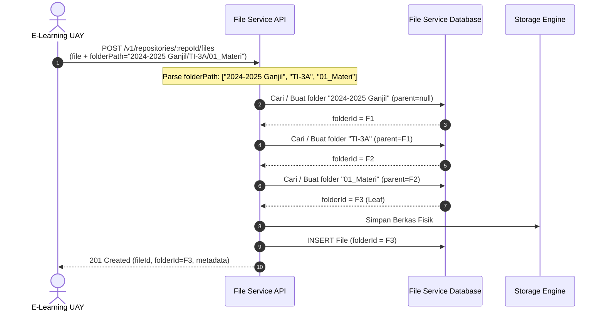

# USULAN FITUR (FEATURE REQUEST / RFC)
## Dukungan Manajemen Direktori Hierarkis Dinamis untuk Klien Aplikasi pada UAY File Service

| Metadata Dokumen | Keterangan |
| :--- | :--- |
| **Nomor Dokumen** | RFC-UAY-FS-2026-001 |
| **Judul Fitur** | Dynamic Hierarchical Directory Management for Application Clients |
| **Pemohon / Pengusul** | Tim Pengembang E-Learning UAY |
| **Ditujukan Kepada** | Tim Pengembang & Administrator UAY File Service |
| **Tanggal Pengajuan** | 13 Oktober 2026 |
| **Status Dokumen** | **PROPOSED (Menunggu Tinjauan Teknis)** |
| **Tingkat Prioritas** | **Tinggi (High / Usability & Scalability)** |

---

## 1. Ringkasan Eksekutif (Executive Summary)

Saat ini seluruh berkas yang diunggah oleh platform klien (**E-Learning UAY**) ke **UAY File Service** tersimpan di tingkat *root repository* (`folder_id: null`). Dengan perkiraan ribuan berkas materi perkuliahan, tugas mahasiswa, berkas kuis, dan lampiran setiap semesternya, penumpukan berkas di level *root* menimbulkan kendala:

1. **Kesulitan Audit & Navigasi Manual**: Pada antarmuka Admin Console File Service, puluhan ribu berkas bercampur menjadi satu tanpa kategorisasi semester atau kelas.
2. **Ketiadaan Isolasi Logis**: Pengelompokan berkas sepenuhnya dibebankan pada database lokal E-Learning melalui metadata `contextId`, sedangkan repositori File Service tidak mencerminkan struktur akademik universitas.
3. **Keterbatasan API M2M Saat Ini**: Endpoint upload aplikasi klien (`POST /v1/repositories/:repositoryId/files`) menerima parameter `folderId`, namun File Service **belum menyediakan endpoint bagi aplikasi klien (Machine-to-Machine / API Key) untuk membuat folder atau membuat jalur direktori secara dinamis**. Endpoint pembuatan folder saat ini hanya ada di rute Console (`POST /v1/console/repositories/:repositoryId/folders`) yang membutuhkan sesi login pengguna SSO interaktif di peramban.

Dokumen ini mengusulkan penambahan kemampuan **Manajemen Direktori Hierarkis Dinamis** pada UAY File Service agar aplikasi klien dapat mengelompokkan berkas secara otomatis tanpa merusak kompatibilitas sistem yang sudah berjalan (*100% backward compatible*).

---

## 2. Analisis Kondisi Saat Ini (Current State Analysis)

### 2.1. Skema Database yang Sudah Ada
Di sisi database File Service (`prisma/schema.prisma`), tabel `Folder` sudah dirancang sangat baik dan mendukung struktur pohon tak terbatas (*self-referencing recursive tree*):

```prisma
model Folder {
  folderId       String   @id @default(dbgenerated("gen_random_uuid()")) @map("folder_id") @db.Uuid
  repositoryId   String   @map("repository_id") @db.Uuid
  parentFolderId String?  @map("parent_folder_id") @db.Uuid
  name           String   @db.VarChar(255)
  status         String   @default("active") @db.VarChar(20)

  parent   Folder?  @relation("FolderTree", fields: [parentFolderId, repositoryId], references: [folderId, repositoryId], onDelete: Restrict)
  children Folder[] @relation("FolderTree")
  files    File[]

  @@unique([folderId, repositoryId])
  @@index([repositoryId])
  @@index([parentFolderId, repositoryId])
  @@map("folders")
}
```

Tabel `File` juga telah memiliki relasi opsional `folderId`:
```prisma
model File {
  fileId       String  @id @default(dbgenerated("gen_random_uuid()")) @map("file_id") @db.Uuid
  repositoryId String  @map("repository_id") @db.Uuid
  folderId     String? @map("folder_id") @db.Uuid
  ...
}
```

### 2.2. Gap / Keterbatasan Teknis API
1. **Tidak Ada Endpoint Pembuatan Folder untuk Klien Aplikasi**:
   Endpoint aplikasi di `/v1/repositories/:repositoryId/...` hanya menangani operasi berkas (`files`), tidak ada handler untuk `folders`.
2. **Endpoint Pembuatan Folder Terkunci di Console**:
   Route `POST /v1/console/repositories/:repositoryId/folders` dilindungi oleh `ConsoleBearerAuthGuard` dan `ConsoleRepositoryManagerGuard` yang memerlukan token sesi pengguna Keycloak Console (`KEYCLOAK_CONSOLE_CLIENT_ID`), sehingga tidak dapat dipanggil menggunakan kredensial M2M / API Key aplikasi E-Learning (`elearning-uay`).
3. **Limit Field Multipart (Multer) di File Service**:
   Pada `filesystem-storage.service.ts`:
   ```ts
   limits: {
     fileSize: maxUploadBytes,
     files: 1,
     fields: 3, // Hanya menerima 3 field teks
     parts: 4,
     fieldSize: 1024,
   }
   ```
   Tiga field yang diterima saat ini adalah `folderId`, `contextType`, dan `contextId`. Jika klien mengirim field tambahan (seperti `folderPath`), Multer akan melemparkan galat `LIMIT_FIELD_COUNT (400 Bad Request)`.

---

## 3. Spesifikasi Usulan Fitur (Proposed Features)

Kami mengusulkan **2 Opsi Solusi** (dapat diimplementasikan salah satu atau keduanya):

### OPSI A (Sangat Direkomendasikan): Dukungan Parameter `folderPath` pada Upload Berkas
Pendekatan ini paling efisien karena bersifat **atomik (1 round-trip)**: aplikasi klien tidak perlu melakukan panggilan terpisah untuk membuat folder sebelum mengunggah berkas.

#### Alur Kerja:
1. Klien mengirim `multipart/form-data` dengan field tambahan `folderPath`, misalnya:
   `folderPath: "2024-2025 Ganjil/[IF101] Pemrograman Web - TI-3A/01_Materi"`
2. File Service memeriksa apakah `folderId` dikirim:
   - Jika `folderId` ada, gunakan `folderId`.
   - Jika `folderId` tidak ada dan `folderPath` ada, File Service secara otomatis membedah segmen jalur (*path segments*) dari kiri ke kanan.
   - Untuk setiap segmen, File Service mencari folder aktif di bawah parent yang sesuai. Jika belum ada, File Service otomatis membuatnya.
   - Folder daun (*leaf folder*) yang dihasilkan dijadikan sebagai `folderId` berkas tersebut.
3. Kenaikan limit Multer: Mengubah `fields: 3` menjadi `fields: 10` dan `parts: 4` menjadi `parts: 12`.



---

### OPSI B: Penambahan Endpoint Folder untuk Klien Aplikasi (`/v1/repositories/:repositoryId/folders`)
Jika File Service lebih menyukai pemisahan tanggung jawab (*separation of concerns*), sediakan endpoint REST folder yang dapat diakses dengan kredensial aplikasi yang sama:

#### Endpoint Baru yang Diusulkan:

1. **`GET /v1/repositories/:repositoryId/folders`**
   - **Tujuan**: Mengambil daftar folder aktif di dalam repository.
   - **Query Params**: `parent_folder_id` (opsional, UUID atau null untuk root).
   - **Hak Akses**: Menggunakan permission `FILE_LIST` (yang sudah dimiliki aplikasi).
   - **Contoh Respons**:
     ```json
     {
       "statusCode": 200,
       "success": true,
       "data": {
         "items": [
           {
             "folderId": "3fa85f64-5717-4562-b3fc-2c963f66afa6",
             "parentFolderId": null,
             "name": "2024-2025 Ganjil",
             "status": "active",
             "createdAt": "2026-10-13T10:00:00Z"
           }
         ]
       }
     }
     ```

2. **`POST /v1/repositories/:repositoryId/folders`**
   - **Tujuan**: Membuat folder baru atau memastikan folder hierarki ada (*ensure path*).
   - **Hak Akses**: Menggunakan permission `FILE_UPLOAD` (yang sudah dimiliki aplikasi).
   - **Payload Model 1 (Single Folder)**:
     ```json
     {
       "name": "01_Materi",
       "parentFolderId": "3fa85f64-5717-4562-b3fc-2c963f66afa6"
     }
     ```
   - **Payload Model 2 (Hierarchical Path Resolver - Ensure Path)**:
     ```json
     {
       "path": "2024-2025 Ganjil/[IF101] Pemrograman Web/01_Materi"
     }
     ```
   - **Perilaku Idempoten**: Jika folder dengan nama/jalur tersebut sudah ada, endpoint tidak mengembalikan error 409 Conflict, melainkan mengembalikan objek folder yang sudah ada (status 200 OK / 201 Created).

---

## 4. Standar Hierarki Direktori E-Learning UAY

Platform E-Learning UAY telah menyiapkan algoritma pemetaan hierarki folder yang akan otomatis dikirimkan ke File Service sebagai berikut:

```
[Repository Root]
├── 2024-2025 Ganjil/
│   ├── [IF101] Pemrograman Web - TI-3A/
│   │   ├── 00_Sampul/
│   │   │   └── banner_kelas.jpg
│   │   ├── 01_Materi/
│   │   │   ├── Modul-01-Pengenalan-HTML.pdf
│   │   │   └── Video-Tutorial-Flexbox.mp4
│   │   ├── 02_Tugas/
│   │   │   ├── tugas_nim_20240101.zip
│   │   │   └── laporan_praktikum_nim_20240102.pdf
│   │   └── 03_Kuis/
│   │       └── lembar_jawaban_kuis1.pdf
│   └── [IF102] Struktur Data - TI-1B/
│       ├── 01_Materi/
│       └── 02_Tugas/
└── Umum/
    └── 04_Lainnya/
```

### Aturan Sanitasi Jalur Direktori:
- Segmen jalur dibatasi maksimal 150 karakter per level.
- Karakter pemisah ilegal (`\`, `/`, control characters) otomatis diubah menjadi `-`.
- Mencegah jalur traversal seperti `.` dan `..`.
- Pemetaan kategori berdasarkan `FileReference.purpose`:
  - `COVER` $\rightarrow$ `00_Sampul`
  - `RESOURCE` / `VIDEO` $\rightarrow$ `01_Materi`
  - `SUBMISSION` $\rightarrow$ `02_Tugas`
  - `QUIZ_ANSWER` $\rightarrow$ `03_Kuis`
  - Kategori lain $\rightarrow$ `04_Lainnya`

---

## 5. Referensi Implementasi Teknis (Untuk Tim File Service)

Sebagai bahan referensi kemudahan tim pengembang File Service, berikut adalah rancangan implementasi yang ringkas dan aman:

### 5.1. Penyesuaian Multer (`filesystem-storage.service.ts`)
```typescript
export function getFileUploadOptions() {
  ...
  return {
    dest: join(resolve(root), '.incoming'),
    limits: {
      fileSize: maxUploadBytes,
      files: 1,
      fields: 10,   // Ditingkatkan dari 3 ke 10 agar menerima folderPath
      parts: 12,    // Ditingkatkan dari 4 ke 12
      fieldSize: 4096,
    },
  };
}
```

### 5.2. Fungsi Resolusi Folder (`files.service.ts`)
```typescript
async ensureFolderPath(
  repositoryId: string,
  folderPath: string,
  actorId?: string,
  request?: FileRequestContext,
  applicationEnvironmentId?: string | null,
): Promise<string> {
  const rawSegments = folderPath
    .replace(/\\/g, '/')
    .split('/')
    .map((s) => s.trim())
    .filter((s) => s.length > 0);

  if (rawSegments.length === 0) {
    throw new BadRequestException('Folder path cannot be empty');
  }
  if (rawSegments.length > 20) {
    throw new BadRequestException('Folder hierarchy depth cannot exceed 20 levels');
  }

  // Validasi awal seluruh segmen untuk fail-fast
  for (const segment of rawSegments) {
    if (segment === '.' || segment === '..' || segment.length > 255 || CONTROL_CHARACTERS.test(segment)) {
      throw new BadRequestException(`Invalid folder segment: "${segment}"`);
    }
  }

  let currentParentId: string | null = null;
  for (const segment of rawSegments) {
    let folder = await this.prisma.folder.findFirst({
      where: {
        repositoryId,
        parentFolderId: currentParentId,
        name: segment,
        status: 'active',
      },
      select: { folderId: true },
    });

    if (!folder) {
      try {
        folder = await this.prisma.folder.create({
          data: {
            repositoryId,
            parentFolderId: currentParentId,
            name: segment,
            status: 'active',
          },
          select: { folderId: true },
        });
      } catch (error: any) {
        // Tangani race condition jika ada upload paralel yang membuat folder yang sama
        if (error?.code === 'P2002') {
          folder = await this.prisma.folder.findFirst({
            where: {
              repositoryId,
              parentFolderId: currentParentId,
              name: segment,
              status: 'active',
            },
            select: { folderId: true },
          });
          if (!folder) throw error;
        } else {
          throw error;
        }
      }
    }
    currentParentId = folder.folderId;
  }

  return currentParentId!;
}
```

### 5.3. Integrasi pada `uploadAs` (`files.service.ts`)
```typescript
// Ambil folderId eksplisit, atau resolve dari folderPath jika tersedia
let folderId = input.folderId;
if (!folderId && input.folderPath) {
  folderId = await this.ensureFolderPath(
    context.repositoryId,
    input.folderPath,
    actorId,
    request,
    context.applicationEnvironmentId,
  );
}

// Simpan file dengan folderId hasil resolusi
const createdFile = await transaction.file.create({
  data: {
    fileId,
    repositoryId: context.repositoryId,
    folderId,
    originalName,
    ...
  }
});
```

---

## 6. Jaminan Kompatibilitas Mundur (Backward Compatibility)

1. **Klien Lama Tetap Berfungsi 100%**:
   Jika aplikasi klien tidak mengirimkan `folderPath` atau mengirimkan `folderId: null`, berkas tetap disimpan di root seperti perilaku sebelumnya.
2. **Tidak Memerlukan Migrasi Database**:
   Model Prisma `Folder` dan relasi pada `File` sudah ada sejak migrasi awal (`20261008040732_init`). Tidak ada perubahan struktur tabel yang diperlukan.
3. **Tidak Memerlukan Hak Akses Baru**:
   Operasi ini memanfaatkan permission `FILE_UPLOAD` dan `FILE_LIST` yang sudah di-grant ke klien aplikasi.

---

## 7. Rangkuman & Langkah Selanjutnya

| Pihak | Tindakan yang Diharapkan |
| :--- | :--- |
| **Tim File Service** | Meninjau usulan RFC ini, menyetujui implementasi Opsi A (parameter `folderPath`) atau Opsi B (endpoint folder), dan menerapkannya pada rilis File Service berikutnya. |
| **Tim E-Learning** | Mengaktifkan pengiriman `folderPath` secara otomatis pada klien integrasi E-Learning begitu fitur dirilis oleh tim File Service. |

*Demikian dokumen usulan fitur ini kami ajukan demi optimalisasi tata kelola penyimpanan data akademik Universitas Al-Amin (UVAYA).*
